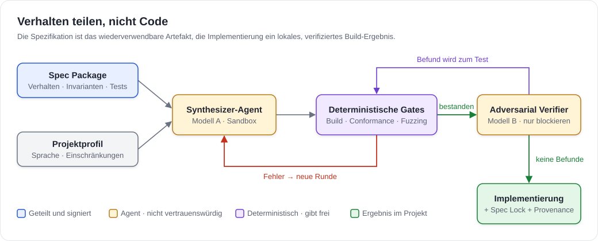
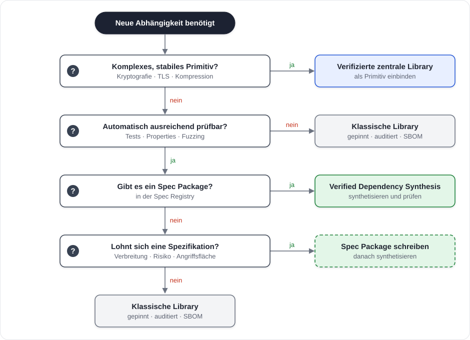
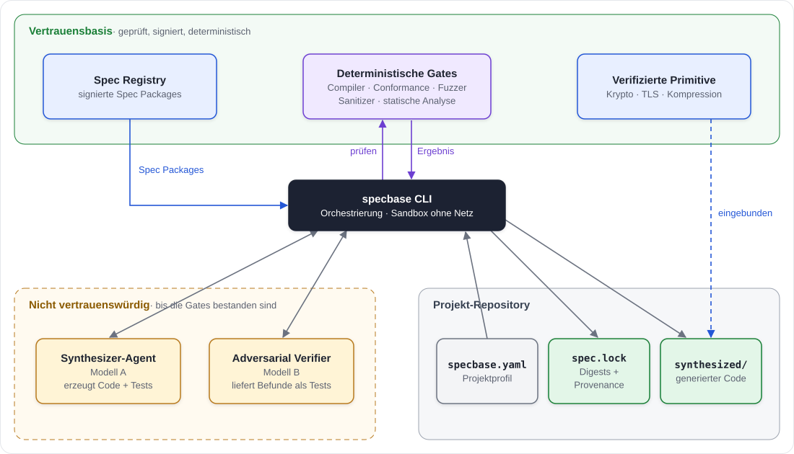
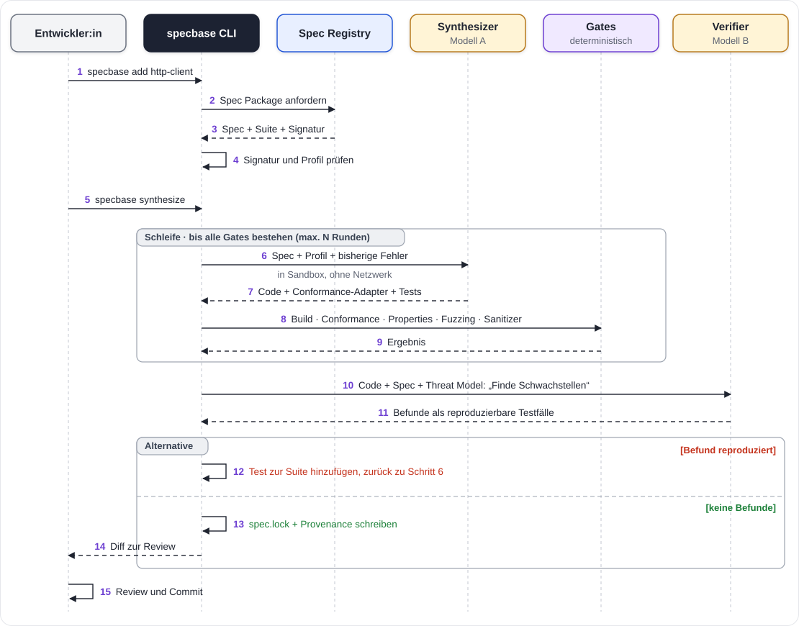
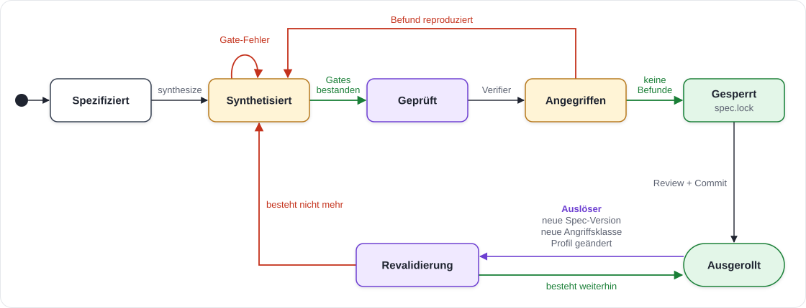
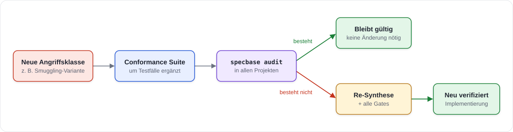
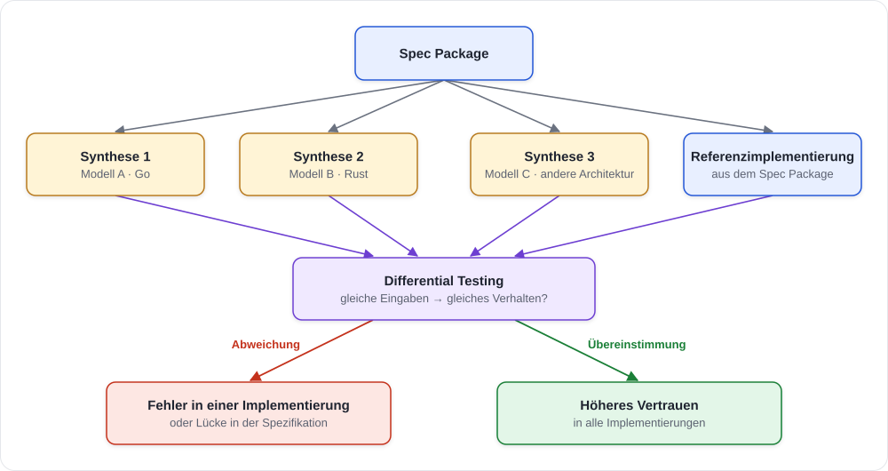

# Verified Dependency Synthesis (VDS)

> **Arbeitstitel:** Specbase (*Specification Base Layer*)
> **Status:** Entwurf · Design-Konzept v0.1 · 2026-10-22

---

## 1. Zusammenfassung

Heute teilen wir **Code**, weil menschliche Implementierungsarbeit teuer ist. Wenn AI Agents Code günstig erzeugen und automatisiert prüfen können, verschiebt sich die optimale Architektur: Wir teilen **geprüfte Verhaltensverträge** statt identischer Implementierungen.

**Verified Dependency Synthesis** ersetzt für eine klar abgegrenzte Klasse von Abhängigkeiten das *Auflösen und Herunterladen* fremden Codes (Dependency Resolution) durch das *Synthetisieren* einer projektspezifischen Implementierung aus einer normativen Spezifikation. Die Implementierung wird anschließend durch deterministische Prüfungen und einen unabhängigen, gegnerischen Prüf-Agent verifiziert.

| | Dependency Resolution (heute) | Dependency Synthesis (VDS) |
|---|---|---|
| Geteilt wird | Implementierungscode | Spezifikation + Conformance Suite |
| Ins Projekt gelangt | fremder Code inkl. transitiver Abhängigkeiten | eigener, generierter, minimaler Code |
| Zuschnitt | generisch, für alle Anwendungsfälle | eingeschränkt auf das Projektprofil |
| Vertrauensanker | Maintainer + Distributionskanal | Spezifikation + deterministische Prüfungen |
| Blast Radius eines Implementierungsfehlers | alle Nutzer der Library | ein Projekt |

**Positionierung in einem Satz:** VDS ersetzt nicht rustls oder HACL\*, sondern die **lange Liste kleiner, ungeprüfter Abhängigkeiten**, über die heute die meisten Supply-Chain-Angriffe laufen.

---

## 2. Problem

### 2.1 Software-Monokultur

Eine weit verbreitete Implementierung ist ein Single Point of Failure. Ein Fehler (oder eine eingeschleuste Hintertür) betrifft schlagartig alle Systeme, die sie nutzen.


### 2.2 Die lange Liste kleiner Abhängigkeiten

Ein typisches Projekt hat wenige große, gut gepflegte Abhängigkeiten und sehr viele kleine. Gerade die kleinen sind kaum geprüft, werden oft von Einzelpersonen gepflegt und bringen eigene transitive Abhängigkeiten mit. Angriffe wie **event-stream** (2018), **ua-parser-js** (2021) oder **xz-utils** (2024) zielten nicht auf fehlerhaften Code, sondern auf den **Verteilungsweg**: übernommene Maintainer-Konten, bösartige Updates, sozial eingeschleuste Co-Maintainer.

### 2.3 Fehlbedienung generischer Libraries

Generische Libraries müssen alles können: Redirects, Proxies, abschaltbare Zertifikatsprüfung, Plugin-Hooks. Ein großer Teil realer Schwachstellen entsteht nicht im Library-Code, sondern in ihrer **Konfiguration und Nutzung**. Eine verifizierte Library beweist, dass *sie* ihre Spezifikation erfüllt, nicht dass *das Projekt* sie sicher einsetzt.

---

## 3. Kernidee

> **Verhalten teilen, nicht Code.**
> Die Spezifikation ist das wiederverwendbare Artefakt. Die Implementierung ist ein lokales, reproduzierbares, verifiziertes Build-Ergebnis.



### 3.1 Designprinzipien

| # | Prinzip | Bedeutung |
|---|---|---|
| P1 | **Agents dürfen blockieren, aber nicht freigeben.** | Freigabe erfolgt ausschließlich durch deterministische Prüfungen. Ein Befund des Prüf-Agents zählt erst, wenn er als reproduzierbarer, fehlschlagender Test vorliegt. |
| P2 | **Generieren und Prüfen sind getrennt.** | Synthesizer und Verifier nutzen unterschiedliche Modelle bzw. Anbieter, um korrelierte blinde Flecken zu reduzieren. |
| P3 | **Profile schränken ein, nie erweitern.** | Das Projektprofil kann den Funktionsumfang der Spezifikation nur verkleinern (keine Redirects, nur ein Host, nur TLS 1.3), nie über sie hinausgehen. |
| P4 | **Was nicht generiert wird, kann nicht angegriffen werden.** | Synthetisiert wird nur der vom Profil benötigte Teil der Spezifikation. |
| P5 | **Diversität zwischen Projekten, Einheitlichkeit innerhalb eines Projekts.** | Innerhalb eines Systems wird eine Spezifikation genau einmal synthetisiert. Zwei unterschiedliche Parser im selben System erzeugen sonst Parser-Differentials (Request Smuggling, SSRF). |
| P6 | **Verifizierte Primitive bleiben zentral.** | Kryptografie, TLS-Kern, Kompression werden nicht synthetisiert, sondern als geprüfte zentrale Libraries eingebunden. |
| P7 | **Alles ist reproduzierbar und nachvollziehbar.** | Jede Synthese wird im Spec Lock mit Digests aller Eingaben, Modelle und Prüfergebnisse festgehalten. |

---

## 4. Abgrenzung: Synthese oder Library?

VDS ist **kein Ersatz für alle Libraries**. Entscheidend sind zwei Fragen: Wie teuer ist es, die Komponente zuverlässig zu prüfen? Und wie stark profitiert sie vom Zuschnitt auf das Projekt?


### 4.1 Entscheidungsbaum



---

## 5. Architektur

### 5.1 Komponenten und Vertrauensgrenzen



| Komponente | Aufgabe | Vertrauen |
|---|---|---|
| **Spec Package** | Normative Spezifikation, Schnittstelle, Invarianten, Conformance Suite, Threat Model | vertrauenswürdig nach Review + Signatur |
| **Spec Registry** | Verteilt signierte Spec Packages (analog zu npm / crates.io) | Angriffsziel, siehe §7 |
| **Projektprofil** (`specbase.yaml`) | Sprache, Zielplattform, Einschränkungen, verwendete Primitive | vom Projekt verantwortet |
| **Synthesizer-Agent** | Erzeugt Implementierung + projektspezifische Tests, läuft in Sandbox ohne Netzwerk | nicht vertrauenswürdig |
| **Deterministische Gates** | Build, Conformance, Property-Tests, Fuzzing, Sanitizer, statische Analyse | Vertrauensanker |
| **Adversarial Verifier** | Sucht aktiv Schwachstellen, liefert Befunde als Testfälle | darf nur blockieren |
| **Spec Lock** (`spec.lock`) | Hält alle Eingaben, Modelle, Ergebnisse und Digests fest | Nachweis / Audit |
| **Synthesized Implementation** | Eingecheckter Code im Projekt, normal reviewbar | Ergebnis |

### 5.2 Aufbau eines Spec Package


**Sprachneutrale Conformance:** Jede synthetisierte Implementierung enthält einen kleinen *Conformance-Adapter*, der das Harness-Protokoll spricht. Dadurch läuft dieselbe Suite gegen Go-, Rust- oder C-Implementierungen als Black Box.

Beispiel für maschinenlesbare Invarianten:

```yaml
# invariants.yaml (Auszug)
- id: TLS-001
  rule: Zertifikatskette MUSS gegen den konfigurierten Trust Store validiert werden.
  tests: [adversarial/tls/expired, adversarial/tls/self-signed, adversarial/tls/wrong-host]
  severity: critical
  overridable: false          # kein Profil darf das abschalten

- id: HTTP-007
  rule: Header-Werte mit CR oder LF MÜSSEN abgelehnt werden.
  tests: [adversarial/header-injection/*]
  severity: critical

- id: MEM-002
  rule: Antwort-Body DARF max_response_bytes nicht überschreiten; Überschreitung ist ein Fehler, kein stilles Abschneiden.
  tests: [vectors/limits/body-*, properties/bounded-memory]
  severity: high
```

### 5.3 Projektprofil

```yaml
# specbase.yaml
project: billing-service
language: go
toolchain: go1.25

dependencies:
  http-client:
    spec: specbase/http-client@1.2.0
    profile:                       # darf nur einschränken (P3)
      http_versions: ["1.1"]
      methods: [GET, POST]
      allowed_hosts: [api.payments.internal]
      redirects: none
      max_response_bytes: 1048576
      timeouts: { connect: 2s, total: 10s }
      tls:
        min_version: "1.3"
        pin: "sha256/<SPKI-Hash>"
    primitives:
      tls: crypto/tls              # verifiziertes Primitiv, wird nicht synthetisiert (P6)

synthesis:
  synthesizer: model-a
  verifier: model-b                # anderes Modell (P2)
  fuzz_minutes: 120
  sandbox: { network: false }
```

### 5.4 Spec Lock

```yaml
# spec.lock (generiert, eingecheckt)
http-client:
  spec: specbase/http-client@1.2.0
  spec_digest: sha256:4f1c…
  profile_digest: sha256:9a02…
  synthesizer: { model: model-a, prompt_digest: sha256:77be… }
  verifier:    { model: model-b, findings: 3, all_resolved: true }
  gates:
    build: pass
    conformance: { suite_digest: sha256:c0de…, passed: 412, failed: 0, skipped_by_profile: 57 }
    fuzz: { minutes: 120, crashes: 0, hangs: 0, corpus_digest: sha256:e1f0… }
    sanitizers: { address: pass, undefined: pass }
    differential: { against: reference, disagreements: 0 }
  output_digest: sha256:b3a9…
  provenance: in-toto attestation (SLSA Level 3)
```

---

## 6. Synthese-Pipeline

### 6.1 Ablauf



### 6.2 Gates im Detail

| Gate | Prüft | Fehlschlag bedeutet |
|---|---|---|
| **Build** | Kompiliert ohne Warnungen, keine verbotenen Imports | zurück an Synthesizer |
| **Profil-Konformität** | Nur erlaubte Primitive, keine Netzwerk-/Dateizugriffe außerhalb des Profils | zurück an Synthesizer |
| **Conformance** | Alle Testvektoren der für das Profil relevanten Spec-Teile | zurück an Synthesizer |
| **Properties** | Property-based Tests (z. B. begrenzter Speicher, Idempotenz) | zurück an Synthesizer |
| **Adversarial Suite** | Bekannte Angriffsklassen aus `conformance/adversarial` | zurück an Synthesizer |
| **Fuzzing + Sanitizer** | Keine Crashes, Hangs, Speicherfehler in der Mindestlaufzeit | zurück an Synthesizer |
| **Differential** | Gleiches Verhalten wie Referenzimplementierung bzw. andere Synthesen | zurück an Synthesizer, ggf. Spec-Fehler melden |
| **Verifier** | Gegnerische Prüfung, Befunde nur als fehlschlagende Tests | Test wird Teil der Suite |

### 6.3 Lebenszyklus einer synthetisierten Abhängigkeit



**Patchen durch Revalidierung:** Wird eine neue Angriffsklasse bekannt, ergänzen die Spec-Maintainer die Conformance Suite. Alle Projekte führen `specbase audit` aus: Bestehende Implementierungen werden gegen die neue Suite geprüft und nur bei Bedarf neu synthetisiert. Das Projekt hängt nicht davon ab, dass ein Upstream-Maintainer einen Patch veröffentlicht.



---

## 7. Sicherheitsmodell

### 7.1 Bedrohungen im Vergleich

| Bedrohung | Klassische Library | VDS | Restrisiko / Gegenmaßnahme |
|---|---|---|---|
| **Kompromittierter Maintainer, bösartiges Update** (xz, event-stream) | trifft alle Nutzer | kein Code-Distributionskanal | Spec-Registry-Poisoning → Signaturen, Mehr-Augen-Review, Specs sind klein und lesbar |
| **Implementierungsfehler** | trifft alle Nutzer gleichzeitig | trifft ein Projekt, wird durch Gates gefiltert | korrelierte Modellfehler → P2, Differential Testing |
| **Fehlkonfiguration, Fehlbedienung** | häufig, API erlaubt unsichere Optionen | Einschränkungen fest eingebaut | falsches Profil → Profil-Schema, `overridable: false` |
| **Transitive Abhängigkeiten** | oft Dutzende | keine, außer verifizierten Primitiven | — |
| **Ungenutzte Funktionalität als Angriffsfläche** | vollständig enthalten | nicht generiert (P4) | — |
| **Spezifikationsfehler** | implizit im Code | trifft alle Synthesen | Spec-Review, Differential gegen Referenz, Diversität hilft hier **nicht** |
| **Manipulierte Agent-Ausgabe** (Backdoor, Prompt Injection) | — (neu) | Agent ist nicht vertrauenswürdig | Sandbox ohne Netz, Gates, Verifier, menschliches Review des Diffs |
| **Parser-Differentials im selben System** | gering bei gemeinsamer Library | neu möglich | P5: eine Synthese pro Spec und System |
| **Compiler, Runtime, Betriebssystem** | bleibt | bleibt | außerhalb des Scopes |

### 7.2 Warum Agents hier einen echten Vorteil haben

1. **Zuschnitt auf das Bedrohungsmodell.** Der Agent kennt das Projektprofil und erzeugt nur, was gebraucht wird. Unsichere Optionen existieren im Code gar nicht erst.
2. **Prüfaufwand kostet fast nichts mehr.** Fuzzing, Property-based Tests und vollständige Prüfung aller Eingabepfade laufen bei jeder Synthese, nicht nur, wenn Zeit dafür ist.
3. **Wiederholbarkeit.** Jede neue Angriffsklasse wird Teil der Suite und gegen jede Implementierung erneut geprüft.

### 7.3 Warum Agents allein nicht reichen

- **Korrelierte blinde Flecken.** Prüft ein Modell den eigenen Code, übersieht es oft dieselben Fehler, die es beim Schreiben gemacht hat.
- **Überzeugende, aber unvollständige Berichte.** Ein Agent kann Sicherheit glaubhaft behaupten. Deshalb gilt P1: Freigabe nur durch deterministische Prüfungen.
- **Unabhängiger Code ≠ unabhängige Fehler.** Knight & Leveson (1986) zeigten für N-Version Programming, dass unabhängig entwickelte Implementierungen häufig dieselben Fehler enthalten. VDS muss Diversität aktiv herstellen und ihre Wirkung messen.

### 7.4 Diversität als Werkzeug

Diversität dient in VDS zwei Zwecken:



1. **Kleinerer Blast Radius** zwischen Projekten (§2.1).
2. **Test-Orakel:** Mehrere unabhängige Synthesen werden gegeneinander getestet. Jede Abweichung ist entweder ein Implementierungsfehler oder eine Unschärfe in der Spezifikation. So verbessert VDS auch die Specs selbst.

Stufen der Diversität, von schwach nach stark: gleiches Modell mit anderem Seed → andere Prompt-/Architekturvorgaben → anderes Modell → anderer Anbieter → andere Sprache.

---

## 8. Entwickler-Workflow (CLI-Skizze)

```bash
specbase add http-client@1.2        # Spec Package holen, Signatur prüfen, Profil anlegen
specbase synthesize                 # Synthese + Gates + Verifier, schreibt spec.lock
specbase verify                     # Gates erneut gegen eingecheckten Code (CI)
specbase audit                      # gegen neueste Suites prüfen, bei Bedarf re-synthetisieren
specbase diff http-client           # Änderungen seit letzter Synthese anzeigen
```

In der CI läuft `specbase verify` wie ein Lockfile-Check: Stimmen Code und `spec.lock` nicht überein oder besteht eine Gate-Prüfung nicht, schlägt der Build fehl.

---

## 9. Evaluation

### 9.1 Forschungsfrage

> Kann eine agentisch synthetisierte, projektspezifische Implementierung bei gleichem Funktionsumfang **nachweisbar weniger ausnutzbare Schwachstellen und weniger systemisches Risiko** verursachen als eine etablierte, gemeinsam genutzte Library?

### 9.2 Metriken

| Metrik | Messung |
|---|---|
| **Conformance** | Anteil bestandener Testvektoren der Suite |
| **Schwachstellendichte** | Gefundene Schwachstellen pro KLOC (Fuzzing, Verifier, externes Audit) |
| **Fehlererkennung** | Mutation Score: Anteil absichtlich eingebauter Fehler, die Gates finden |
| **Angriffsfläche** | Codezeilen, öffentliche API, erreichbare Codepfade im Vergleich zur Library |
| **Fehlerkorrelation** | Anteil gemeinsamer Fehler zwischen N unabhängigen Synthesen |
| **Patch-Latenz** | Zeit von neuer Angriffsklasse bis alle Projekte revalidiert sind |
| **Kosten** | Zeit und Tokens pro Synthese und pro Revalidierung |

### 9.3 Experiment-Design


Kandidaten für die erste Komponente, jeweils mit bereits existierender Conformance Suite:

| Kandidat | Vorhandene Spec / Suite | Warum interessant |
|---|---|---|
| **JSON-Parser** | RFC 8259, JSONTestSuite | klein, gut messbar, viele bekannte Parser-Abweichungen |
| **URL-Parser** | WHATWG URL Standard, Web Platform Tests | Parser-Differentials sind eine reale SSRF-Ursache |
| **HTTP/1.1-Client** | RFC 9110/9112, eigene Suite nötig | Beispiel aus dem Konzept, stärkster Profil-Effekt, aber mehr Aufwand |

---

## 10. Roadmap


| Phase | Ziel | Erfolgskriterium |
|---|---|---|
| **A** | Beweisen, dass das Modell für eine Komponente funktioniert | Metriken aus §9.2 mindestens gleichwertig zur Baseline-Library |
| **B** | Für ausgewählte Komponenten ohne fremden Code bauen | Mehrere reale Projekte ersetzen kleine Abhängigkeiten durch VDS |
| **C** | Projektspezifische Softwarebasis vollständig aus Specs | Baselayer wird automatisch synthetisiert, revalidiert und erweitert |

---

## 11. Risiken und offene Punkte

| Risiko | Auswirkung | Umgang |
|---|---|---|
| Spezifikationen sind schwerer zu schreiben als Code | langsame Verbreitung | mit Komponenten beginnen, für die Specs und Suites existieren |
| Kosten pro Synthese | Tokens, CI-Zeit | Caching über `spec.lock`, Re-Synthese nur bei fehlschlagender Revalidierung |
| Spec Registry als neues Angriffsziel | Supply Chain verschiebt sich | Signaturen, Transparenz-Log, Mehr-Augen-Review, kleine Specs |
| Wartbarkeit generierten Codes | Debugging fremd wirkenden Codes | Code wird eingecheckt und reviewt, Stilvorgaben im Profil |
| Rechtliche Fragen | Lizenz generierten Codes, Nähe zu Trainingsdaten | klären, bevor Phase B startet |
| Korrelierte Modellfehler | Diversität wirkt schwächer als erwartet | messen (§9.2), mehrere Anbieter |

---

## 12. Verwandte Arbeiten

| Thema | Bezug |
|---|---|
| **N-Version Programming** (Avizienis, 1977/1985) | Fehlertoleranz durch unabhängig entwickelte Implementierungen einer Spezifikation |
| **Knight & Leveson** (1986) | Experimenteller Nachweis korrelierter Fehler bei unabhängigen Implementierungen |
| **Software-Monokultur** (Geer et al., 2003) | Sicherheitsrisiko durch homogene Software-Landschaften |
| **HACL\*, seL4, rustls** | Formal verifizierte bzw. hochgeprüfte zentrale Implementierungen, in VDS die „Primitive“ |
| **SLSA, in-toto, Reproducible Builds** | Provenance und Nachvollziehbarkeit von Build-Ergebnissen |
| **Spec-Driven Development** | Spezifikation als primäres Artefakt agentischer Entwicklung |
| **Differential Testing, Property-based Testing, Fuzzing** | Prüfverfahren der Gates |

---

## 13. Glossar

| Begriff | Bedeutung |
|---|---|
| **Spec Package** | Verteilbare Einheit aus normativer Spezifikation, Schnittstelle, Invarianten, Threat Model und Conformance Suite |
| **Projektprofil** | Projektspezifische Einschränkungen einer Spezifikation (`specbase.yaml`) |
| **Synthese** | Erzeugen einer Implementierung aus Spec Package + Projektprofil durch einen Agent |
| **Gate** | Deterministische Prüfung, die über Freigabe entscheidet |
| **Adversarial Verifier** | Prüf-Agent mit anderem Modell, der Schwachstellen als Testfälle liefert |
| **Spec Lock** | Datei mit Digests aller Eingaben, Modelle und Prüfergebnisse einer Synthese |
| **Primitiv** | Komplexe, verifizierte Komponente, die zentral bleibt (Krypto, TLS, Kompression) |
| **Revalidierung** | Erneute Prüfung bestehender Implementierungen gegen aktualisierte Suites |
| **Blast Radius** | Anzahl der Systeme, die von einer einzelnen Schwachstelle betroffen sind |
