# Verified Dependency Synthesis (VDS)

> **Working title:** Specbase (*Specification Base Layer*)
> **Status:** Draft · Design concept v0.1 · 2026-10-22

---

## 1. Summary

Today we share **code** because human implementation work is expensive. Once AI agents can generate code cheaply and verify it automatically, the optimal architecture shifts: we share **verified behavioral contracts** instead of identical implementations.

**Verified Dependency Synthesis** replaces, for a clearly bounded class of dependencies, the *resolving and downloading* of third-party code (dependency resolution) with the *synthesis* of a project-specific implementation from a normative specification. The implementation is then verified by deterministic checks and an independent, adversarial verifier agent.

| | Dependency resolution (today) | Dependency synthesis (VDS) |
|---|---|---|
| What is shared | Implementation code | Specification + conformance suite |
| What enters the project | Third-party code incl. transitive dependencies | Own, generated, minimal code |
| Scope | Generic, for every use case | Restricted to the project profile |
| Trust anchor | Maintainers + distribution channel | Specification + deterministic checks |
| Blast radius of an implementation bug | Every user of the library | One project |

**Positioning in one sentence:** VDS does not replace rustls or HACL\*; it replaces the **long tail of small, unverified dependencies** through which most supply chain attacks happen today.

---

## 2. Problem

### 2.1 Software monoculture

A widely used implementation is a single point of failure. One bug (or an injected backdoor) hits every system that uses it at once.

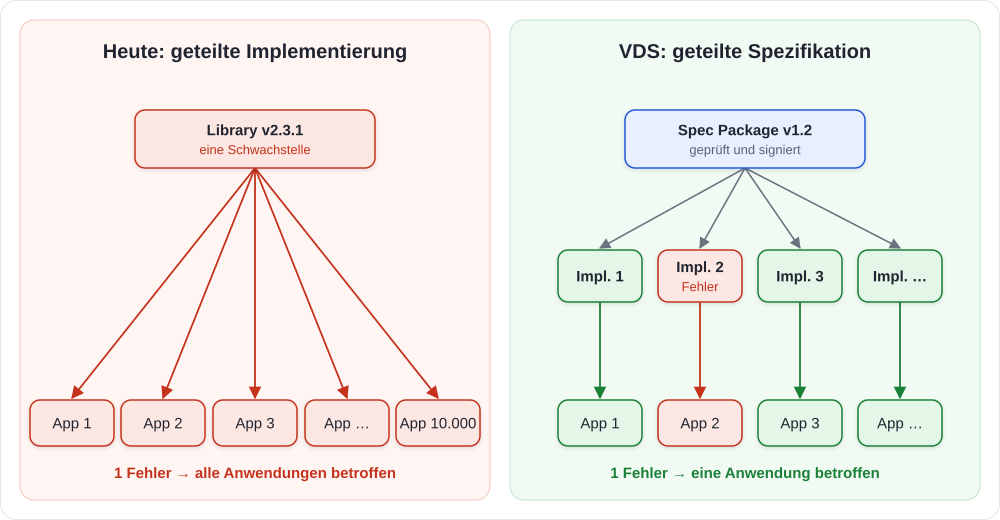

### 2.2 The long tail of small dependencies

A typical project has a few large, well-maintained dependencies and very many small ones. The small ones are barely reviewed, often maintained by a single person, and bring their own transitive dependencies. Attacks such as **event-stream** (2018), **ua-parser-js** (2021) or **xz-utils** (2024) did not target buggy code but the **distribution path**: hijacked maintainer accounts, malicious updates, socially engineered co-maintainers.

### 2.3 Misuse of generic libraries

Generic libraries have to support everything: redirects, proxies, switchable certificate verification, plugin hooks. A large share of real vulnerabilities does not originate in library code but in its **configuration and use**. A verified library proves that *it* meets its specification, not that *the project* uses it safely.

---

## 3. Core idea

> **Share behavior, not code.**
> The specification is the reusable artifact. The implementation is a local, reproducible, verified build output.

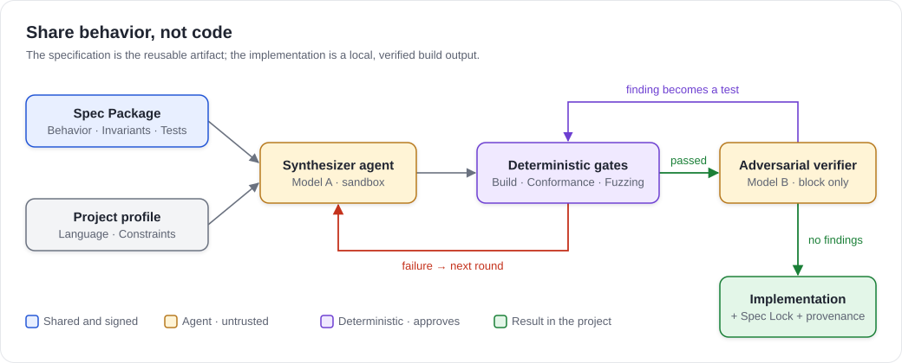

### 3.1 Design principles

| # | Principle | Meaning |
|---|---|---|
| P1 | **Agents may block, but never approve.** | Approval comes exclusively from deterministic checks. A verifier finding only counts once it exists as a reproducible, failing test. |
| P2 | **Generation and verification are separate.** | Synthesizer and verifier use different models or vendors to reduce correlated blind spots. |
| P3 | **Profiles restrict, never extend.** | A project profile can only narrow the scope of the specification (no redirects, a single host, TLS 1.3 only), never go beyond it. |
| P4 | **What is not generated cannot be attacked.** | Only the part of the specification the profile needs is synthesized. |
| P5 | **Diversity across organizations, uniformity within one.** | Within an organization, a specification is synthesized once per profile and shared (§5.5). An organization's services form one system, and two different parsers in the same system create parser differentials (request smuggling, SSRF). |
| P6 | **Verified primitives stay central.** | Cryptography, the TLS core and compression are not synthesized but included as verified central libraries. |
| P7 | **Everything is reproducible and traceable.** | Every synthesis is recorded in the spec lock with digests of all inputs, models and check results. |

---

## 4. Scope: synthesis or library?

VDS is **not a replacement for all libraries**. Two questions decide: how expensive is it to verify the component reliably? And how much does it benefit from being tailored to the project?

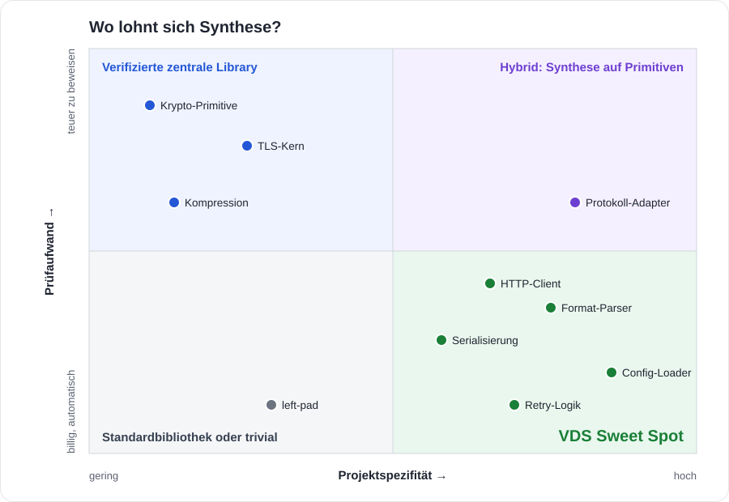

### 4.1 Decision tree

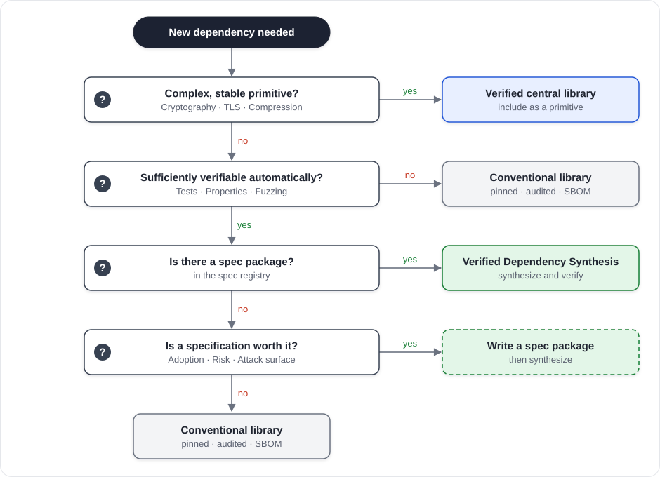

---

## 5. Architecture

### 5.1 Components and trust boundaries

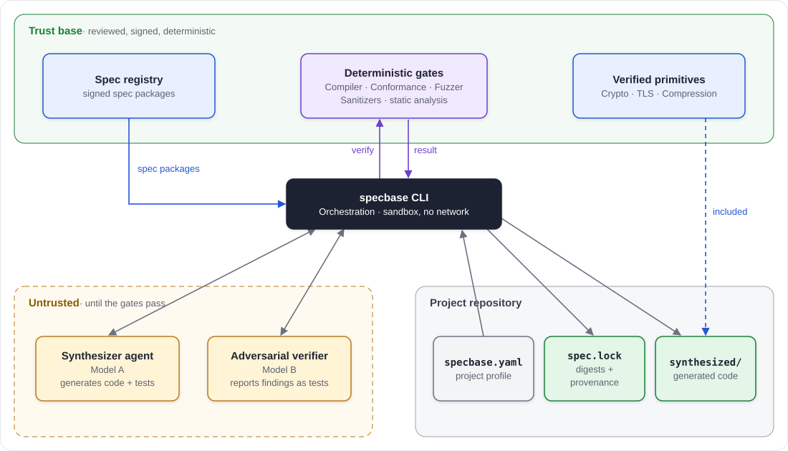

| Component | Responsibility | Trust |
|---|---|---|
| **Spec package** | Normative specification, interface, invariants, conformance suite, threat model | Trusted after review + signature |
| **Spec registry** | Distributes signed spec packages (analogous to npm / crates.io) | Attack target, see §7 |
| **Project profile** (`specbase.yaml`) | Language, target platform, constraints, primitives in use | Owned by the project |
| **Synthesizer agent** | Generates the implementation + project-specific tests, runs in a sandbox without network | Untrusted |
| **Deterministic gates** | Build, conformance, property tests, fuzzing, sanitizers, static analysis | Trust anchor |
| **Adversarial verifier** | Actively hunts for vulnerabilities, reports findings as test cases | May only block |
| **Spec lock** (`spec.lock`) | Records all inputs, models, results and digests | Evidence / audit |
| **Synthesized implementation** | Code checked into the project, reviewable like any other code | Result |
| **Spec mirror** (optional) | Organization-internal copy of the registry with review and quarantine (§5.5) | Trusted after internal approval |
| **Synthesis registry** (optional) | Shares verified syntheses within an organization, keyed by spec, profile, language and toolchain (§5.5) | Verified again on every use |

### 5.2 Structure of a spec package

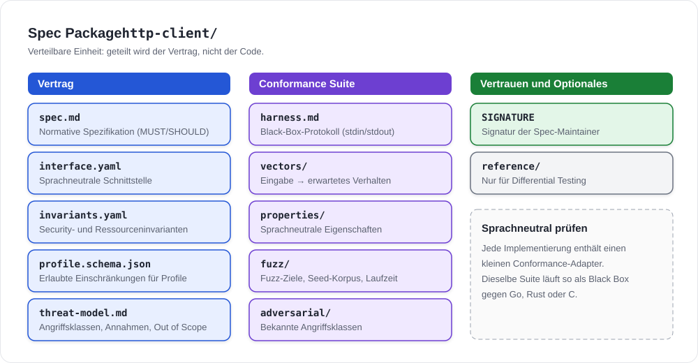

**Language-neutral conformance:** Every synthesized implementation contains a small *conformance adapter* that speaks the harness protocol. This lets the same suite run as a black box against Go, Rust or C implementations.

Example of machine-readable invariants:

```yaml
# invariants.yaml (excerpt)
- id: TLS-001
  rule: The certificate chain MUST be validated against the configured trust store.
  tests: [adversarial/tls/expired, adversarial/tls/self-signed, adversarial/tls/wrong-host]
  severity: critical
  overridable: false          # no profile may disable this

- id: HTTP-007
  rule: Header values containing CR or LF MUST be rejected.
  tests: [adversarial/header-injection/*]
  severity: critical

- id: MEM-002
  rule: The response body MUST NOT exceed max_response_bytes; exceeding it is an error, not silent truncation.
  tests: [vectors/limits/body-*, properties/bounded-memory]
  severity: high
```

### 5.3 Project profile

```yaml
# specbase.yaml
project: billing-service
language: go
toolchain: go1.25
registry: https://specs.internal.example.com   # company spec mirror (§5.5)

dependencies:
  http-client:
    spec: specbase/http-client@1.2.0
    profile:                       # may only restrict (P3)
      http_versions: ["1.1"]
      methods: [GET, POST]
      allowed_hosts: [api.payments.internal]
      redirects: none
      max_response_bytes: 1048576
      timeouts: { connect: 2s, total: 10s }
      tls:
        min_version: "1.3"
        pin: "sha256/<SPKI hash>"
    primitives:
      tls: crypto/tls              # verified primitive, not synthesized (P6)

synthesis:
  scope: organization              # share per profile within the organization (§5.5)
  synthesizer: model-a
  verifier: model-b                # different model (P2)
  fuzz_minutes: 120
  sandbox: { network: false }
```

### 5.4 Spec lock

```yaml
# spec.lock (generated, checked in)
http-client:
  spec: specbase/http-client@1.2.0
  spec_digest: sha256:4f1c…
  profile_digest: sha256:9a02…
  synthesizer: { model: model-a, prompt_digest: sha256:77be… }
  verifier:    { model: model-b, findings: 3, all_resolved: true }
  gates:
    build: pass
    conformance: { suite_digest: sha256:c0de…, passed: 412, failed: 0, skipped_by_profile: 57 }
    fuzz: { minutes: 120, crashes: 0, hangs: 0, corpus_digest: sha256:e1f0… }
    sanitizers: { address: pass, undefined: pass }
    differential: { against: reference, disagreements: 0 }
  output_digest: sha256:b3a9…
  provenance: in-toto attestation (SLSA Level 3)
```

### 5.5 Distribution: spec mirror and synthesis scope

A single public spec registry is a central hub, exactly the kind of concentration VDS sets out to avoid. Two mechanisms reduce that concentration without giving up the benefits of the model.

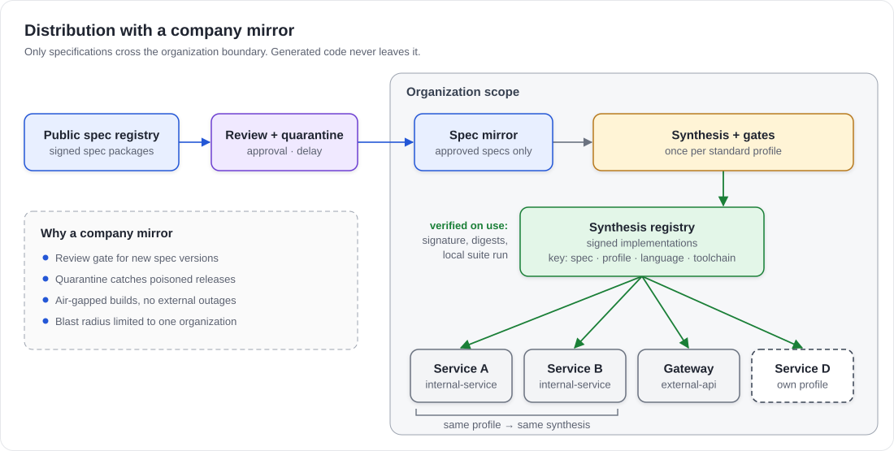

**Company spec mirror.** Organizations do not consume the public registry directly, but through an internal mirror:

- **Review gate:** new spec versions enter the mirror only after internal approval.
- **Quarantine:** new versions are adopted only after a delay. Many supply chain attacks are detected within days.
- **Availability:** air-gapped builds are possible, and an outage of the public registry blocks no build.

Only specifications cross the organization boundary. Generated code never does.

**Synthesis scope.** A synthesis does not have to be generated per application. An organization can synthesize once per profile and share the verified result internally through a synthesis registry. This deliberately relaxes "every application has its own implementation", but less than it seems:

- The monoculture argument is about **mass exploitation across organizations**: one vulnerability, ten thousand companies. With organization scope, the blast radius is one organization, not the ecosystem.
- It even strengthens P5. An organization's services form one system. When gateway and backend share a synthesis, there are no parsing differences between them that would enable request smuggling.
- Synthesis cost is paid once, the security team can review one implementation thoroughly instead of fifty superficially, and a new attack class requires revalidating one artifact.

**What is lost, and how to contain it.** The real loss is not diversity but tailoring (P4): a shared synthesis has to fit every application that uses it. That is why sharing happens per **profile**, not per spec. The registry key is the combination of spec version, profile, language and toolchain. In practice an organization defines a few **standard profiles**, for example `internal-service` (internal hosts only, mTLS) and `external-api` (host allowlist, no redirects). Applications with the same profile share a synthesis; special cases get their own.

**New risk.** The synthesis registry becomes an internal attack target: whoever compromises it reaches every application. Projects therefore never adopt code blindly. On every use they check the signature and the `spec.lock` digests and rerun the conformance suite locally. That is cheap because nothing is regenerated.

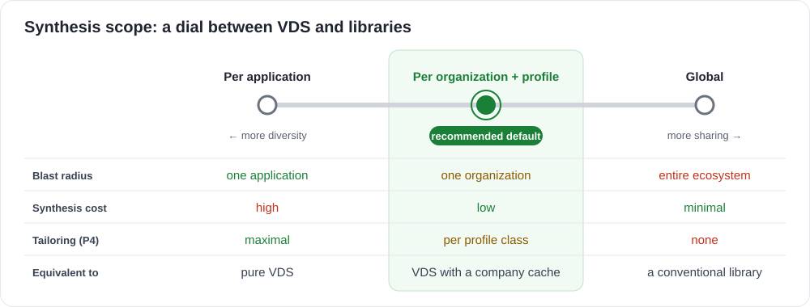

The scope is the dial between both worlds: with global scope, VDS turns back into a conventional library. **Organization + profile** is the recommended default.

---

## 6. Synthesis pipeline

### 6.1 Flow

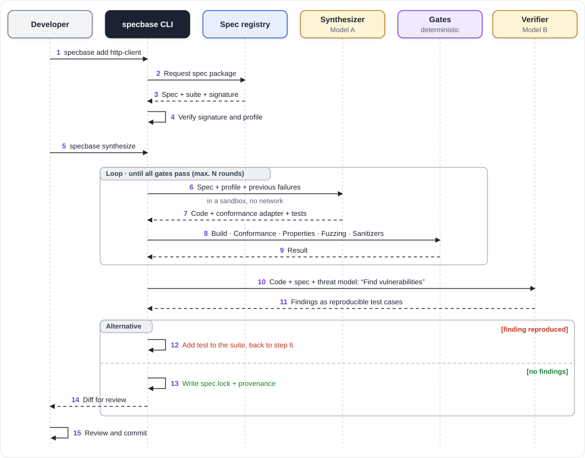

### 6.2 Gates in detail

| Gate | Checks | Failure means |
|---|---|---|
| **Build** | Compiles without warnings, no forbidden imports | Back to the synthesizer |
| **Profile conformance** | Only permitted primitives, no network or file access outside the profile | Back to the synthesizer |
| **Conformance** | All test vectors of the spec parts relevant to the profile | Back to the synthesizer |
| **Properties** | Property-based tests (e.g. bounded memory, idempotence) | Back to the synthesizer |
| **Adversarial suite** | Known attack classes from `conformance/adversarial` | Back to the synthesizer |
| **Fuzzing + sanitizers** | No crashes, hangs or memory errors within the minimum duration | Back to the synthesizer |
| **Differential** | Same behavior as the reference implementation or other syntheses | Back to the synthesizer, possibly report a spec defect |
| **Verifier** | Adversarial review, findings only as failing tests | The test becomes part of the suite |

### 6.3 Lifecycle of a synthesized dependency

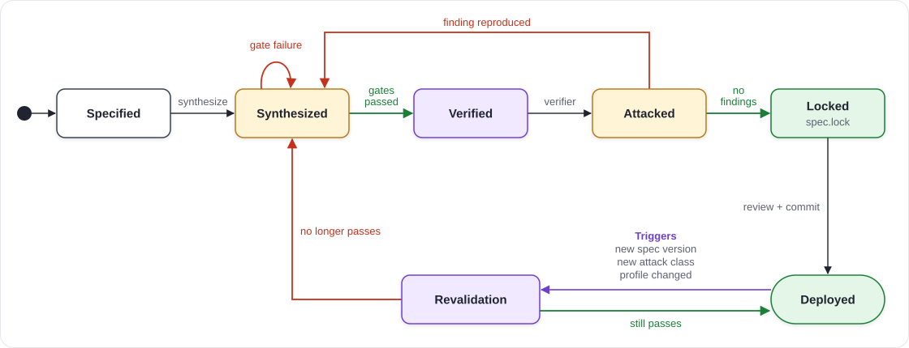

**Patching through revalidation:** When a new attack class becomes known, the spec maintainers extend the conformance suite. Every project runs `specbase audit`: existing implementations are checked against the new suite and only re-synthesized if needed. The project does not depend on an upstream maintainer publishing a patch.

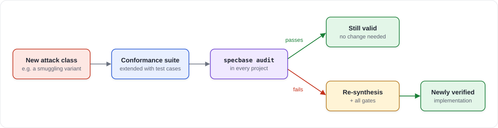

---

## 7. Security model

### 7.1 Threats compared

| Threat | Conventional library | VDS | Residual risk / mitigation |
|---|---|---|---|
| **Compromised maintainer, malicious update** (xz, event-stream) | Hits every user | No code distribution channel | Spec registry poisoning → signatures, multi-party review, small readable specs, company mirror with quarantine (§5.5) |
| **Compromised internal synthesis registry** | — (new) | Hits one organization | Signature and digest check plus a local conformance run on every use (§5.5) |
| **Implementation bug** | Hits every user at once | Hits one project, filtered by the gates | Correlated model errors → P2, differential testing |
| **Misconfiguration, misuse** | Common, the API allows unsafe options | Constraints are built in | Wrong profile → profile schema, `overridable: false` |
| **Transitive dependencies** | Often dozens | None, except verified primitives | — |
| **Unused functionality as attack surface** | Fully included | Not generated (P4) | — |
| **Specification bug** | Implicit in the code | Hits every synthesis | Spec review, differential testing against the reference; diversity does **not** help here |
| **Manipulated agent output** (backdoor, prompt injection) | — (new) | The agent is untrusted | Sandbox without network, gates, verifier, human review of the diff |
| **Parser differentials within one system** | Low with a shared library | Newly possible | P5: one synthesis per spec and profile within an organization |
| **Compiler, runtime, operating system** | Remains | Remains | Out of scope |

### 7.2 Why agents have a real advantage here

1. **Tailored to the threat model.** The agent knows the project profile and generates only what is needed. Unsafe options never exist in the code.
2. **Verification is almost free.** Fuzzing, property-based tests and full coverage of all input paths run on every synthesis, not only when there is time for them.
3. **Repeatability.** Every new attack class becomes part of the suite and is checked again against every implementation.

### 7.3 Why agents alone are not enough

- **Correlated blind spots.** When a model reviews its own code, it often misses the same mistakes it made while writing it.
- **Convincing but incomplete reports.** An agent can claim security plausibly. That is why P1 applies: approval comes only from deterministic checks.
- **Independent code ≠ independent failures.** Knight & Leveson (1986) showed for N-version programming that independently developed implementations frequently contain the same bugs. VDS has to create diversity deliberately and measure its effect.

### 7.4 Diversity as a tool

Diversity serves two purposes in VDS:

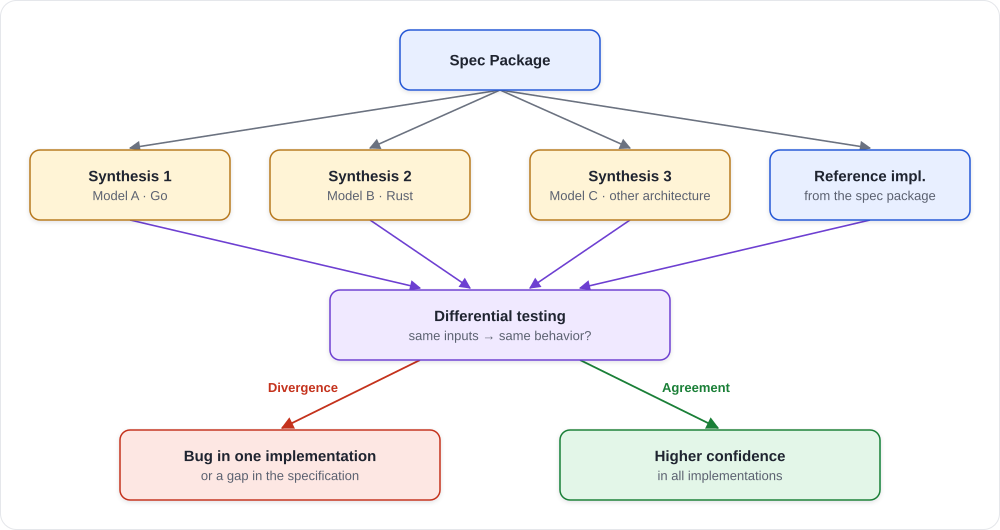

1. **Smaller blast radius** across projects (§2.1).
2. **Test oracle:** Several independent syntheses are tested against each other. Every divergence is either an implementation bug or an ambiguity in the specification. This way VDS also improves the specs themselves.

Levels of diversity, from weak to strong: same model with a different seed → different prompt and architecture constraints → different model → different vendor → different language.

---

## 8. Developer workflow (CLI sketch)

```bash
specbase add http-client@1.2        # fetch spec package, verify signature, create profile
specbase synthesize                 # synthesis + gates + verifier, writes spec.lock
specbase verify                     # re-run gates against the checked-in code (CI)
specbase audit                      # check against the latest suites, re-synthesize if needed
specbase diff http-client           # show changes since the last synthesis
```

In CI, `specbase verify` works like a lockfile check: if code and `spec.lock` do not match or a gate fails, the build fails.

---

## 9. Evaluation

### 9.1 Research question

> Can an agentically synthesized, project-specific implementation with the same functionality be shown to cause **fewer exploitable vulnerabilities and less systemic risk** than an established, widely shared library?

### 9.2 Metrics

| Metric | Measurement |
|---|---|
| **Conformance** | Share of passed test vectors in the suite |
| **Vulnerability density** | Vulnerabilities found per KLOC (fuzzing, verifier, external audit) |
| **Fault detection** | Mutation score: share of deliberately injected bugs the gates detect |
| **Attack surface** | Lines of code, public API, reachable code paths compared to the library |
| **Failure correlation** | Share of common bugs across N independent syntheses |
| **Patch latency** | Time from a new attack class until every project is revalidated |
| **Cost** | Time and tokens per synthesis and per revalidation |

### 9.3 Experiment design

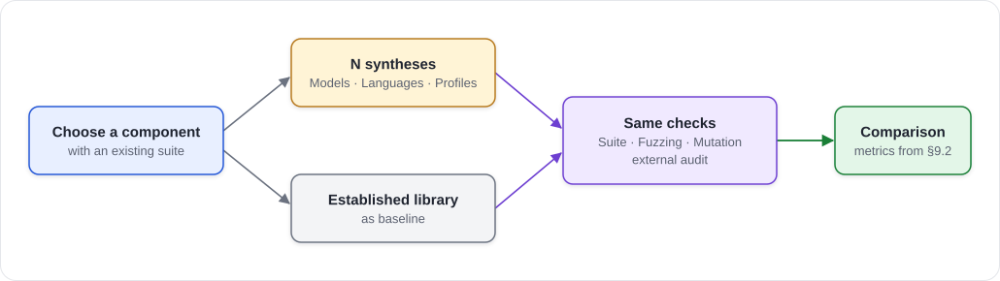

Candidates for a first component, each with an existing conformance suite:

| Candidate | Existing spec / suite | Why it is interesting |
|---|---|---|
| **JSON parser** | RFC 8259, JSONTestSuite | Small, easy to measure, many known parser discrepancies |
| **URL parser** | WHATWG URL Standard, Web Platform Tests | Parser differentials are a real cause of SSRF |
| **HTTP/1.1 client** | RFC 9110/9112, own suite required | The example used throughout this concept, strongest profile effect, but more effort |

---

## 10. Roadmap

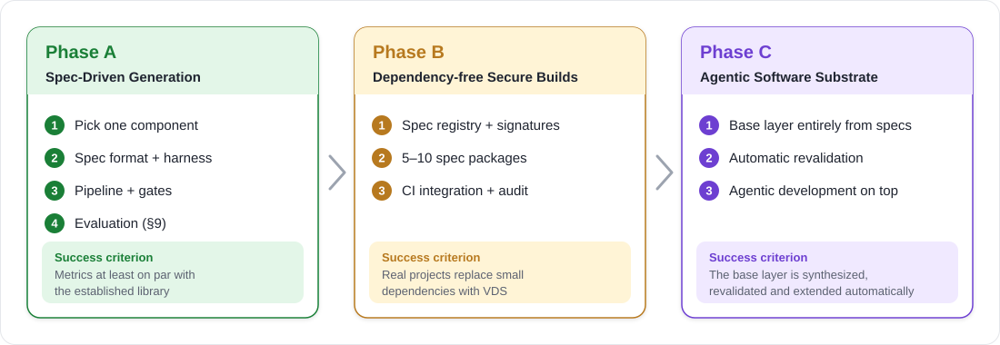

| Phase | Goal | Success criterion |
|---|---|---|
| **A** | Show that the model works for one component | Metrics from §9.2 at least on par with the baseline library |
| **B** | Build selected components without third-party code | Several real projects replace small dependencies with VDS |
| **C** | Project-specific software base entirely from specs | The base layer is synthesized, revalidated and extended automatically |

---

## 11. Risks and open questions

| Risk | Impact | Mitigation |
|---|---|---|
| Specifications are harder to write than code | Slow adoption | Start with components for which specs and suites already exist |
| Cost per synthesis | Tokens, CI time | Caching via `spec.lock`, re-synthesis only when revalidation fails |
| Spec registry as a new attack target | The supply chain shifts | Signatures, transparency log, multi-party review, small specs, company mirrors with quarantine |
| Maintainability of generated code | Debugging code that feels foreign | Code is checked in and reviewed, style rules in the profile |
| Legal questions | Licensing of generated code, proximity to training data | Clarify before phase B starts |
| Correlated model errors | Diversity is less effective than expected | Measure it (§9.2), use multiple vendors |

---

## 12. Related work

| Topic | Relevance |
|---|---|
| **N-version programming** (Avizienis, 1977/1985) | Fault tolerance through independently developed implementations of one specification |
| **Knight & Leveson** (1986) | Experimental evidence of correlated failures across independent implementations |
| **Software monoculture** (Geer et al., 2003) | Security risk of homogeneous software landscapes |
| **HACL\*, seL4, rustls** | Formally verified or heavily reviewed central implementations; the "primitives" in VDS |
| **SLSA, in-toto, reproducible builds** | Provenance and traceability of build outputs |
| **Spec-driven development** | The specification as the primary artifact of agentic development |
| **Differential testing, property-based testing, fuzzing** | Verification techniques used by the gates |

---

## 13. Glossary

| Term | Meaning |
|---|---|
| **Spec package** | Distributable unit made of normative specification, interface, invariants, threat model and conformance suite |
| **Project profile** | Project-specific constraints on a specification (`specbase.yaml`) |
| **Synthesis** | Generating an implementation from spec package + project profile with an agent |
| **Gate** | Deterministic check that decides on approval |
| **Adversarial verifier** | Verifier agent on a different model that reports vulnerabilities as test cases |
| **Spec lock** | File holding the digests of all inputs, models and check results of a synthesis |
| **Primitive** | Complex, verified component that stays central (cryptography, TLS, compression) |
| **Revalidation** | Re-checking existing implementations against updated suites |
| **Spec mirror** | Organization-internal copy of the spec registry with review gate and quarantine |
| **Synthesis registry** | Organization-internal store of verified syntheses, keyed by spec, profile, language and toolchain |
| **Synthesis scope** | How widely a synthesis is shared: per application, per organization + profile, or global |
| **Standard profile** | Organization-wide project profile (e.g. `internal-service`) that lets applications share a synthesis |
| **Blast radius** | Number of systems affected by a single vulnerability |

---

## Diagrams

All diagrams are SVG files in [`diagrams/`](diagrams/), generated by `node diagrams/build.js`.
