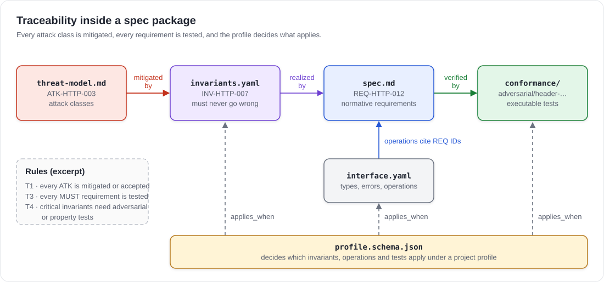

# Spec Package Format

> [!NOTE]
> **Status:** Draft · format version `vds-spec/0.1` · normative.
> This part defines the files of a spec package. The ideas behind spec packages are explained in the [design concept](../README.md).

A **spec package** is the unit that VDS distributes instead of code. It describes the behavior of one component, for example an HTTP client, precisely enough that an agent can synthesize an implementation and deterministic gates can verify it. This format defines which files a spec package contains, what each file must state, and the rules that tie the files together.

## Conventions

The key words MUST, MUST NOT, REQUIRED, SHALL, SHALL NOT, SHOULD, SHOULD NOT, RECOMMENDED, MAY and OPTIONAL are to be interpreted as described in BCP 14 ([RFC 2119](https://www.rfc-editor.org/rfc/rfc2119), [RFC 8174](https://www.rfc-editor.org/rfc/rfc8174)) when, and only when, they appear in all capitals.

- All text files MUST be UTF-8 without a byte order mark and MUST use LF line endings.
- YAML files MUST conform to YAML 1.2 and MUST NOT use anchors, aliases or custom tags.
- JSON Schema documents MUST use draft 2020-12.
- **Durations** are strings made of a non-negative integer and a unit (`ms`, `s` or `m`), for example `250ms` or `10s`.
- **Byte sizes** are non-negative integers counting bytes.

## Package contents

| Path | Required | Purpose | Defined in |
|---|---|---|---|
| `package.yaml` | yes | Manifest: name, version, ID areas, required primitives | [package.yaml](manifest.md) |
| `spec.md` | yes | Normative requirements in prose | [spec.md](spec-md.md) |
| `interface.yaml` | yes | Language-neutral interface: types, errors, environment, operations | [interface.yaml](interface.md) |
| `invariants.yaml` | yes | Machine-readable security and resource invariants | [invariants.yaml](invariants.md) |
| `profile.schema.json` | yes | Profile parameters and how far a project may restrict them | [profile.schema.json](profile.md) |
| `threat-model.md` | yes | Attack classes, assumptions, residual risks | [threat-model.md](threat-model.md) |
| `conformance/` | yes | Conformance suite: suite manifest, test vectors, properties, fuzz targets, adversarial tests, fixtures | [Conformance suite](conformance.md) |
| `reference/` | no | Reference implementation, used only for differential testing | [Conformance suite](conformance.md#reference-implementation) |

Besides these entries, the top level of a package MAY contain `README.md` and `LICENSE` files, which are not normative. It MUST NOT contain anything else.

## Identifiers

Every element that other files refer to has a stable identifier.

| Identifier | Pattern | Example | Declared in |
|---|---|---|---|
| Package name | `<namespace>/<name>`, each part matching `[a-z0-9]+(-[a-z0-9]+)*` | `specbase/http-client` | `package.yaml` |
| Area | `[A-Z][A-Z0-9]{1,7}` | `HTTP` | `package.yaml` → `areas` |
| Requirement | `REQ-<AREA>-<NNN>` | `REQ-HTTP-012` | `spec.md` |
| Invariant | `INV-<AREA>-<NNN>` | `INV-HTTP-007` | `invariants.yaml` |
| Attack class | `ATK-<AREA>-<NNN>` | `ATK-HTTP-003` | `threat-model.md` |
| Test | `<kind>/<segment>(/<segment>)*`, kind is `vectors`, `properties`, `fuzz` or `adversarial` | `adversarial/header-injection/crlf-in-value` | `conformance/` |
| Operation, error kind, type field | `[a-z][a-z0-9_]*` | `invalid_header` | `interface.yaml` |
| Profile parameter | dotted path of property names | `tls.min_version` | `profile.schema.json` |

`<NNN>` is a number with at least three digits. A segment matches `[a-z0-9]+(-[a-z0-9]+)*`.

- Every `<AREA>` used in an identifier MUST be declared in `package.yaml`.
- Identifiers MUST be unique within a package.
- An identifier MUST NOT be reused for a different meaning in any later version of the package. A removed element keeps its identifier and is marked as `withdrawn`.

**Test references.** Wherever a field lists tests, it accepts test identifiers and glob patterns. In a pattern, `*` matches any characters within one segment and `**` matches any number of segments. Every pattern MUST match at least one test.

## Traceability

The files of a package form one chain: attack classes are mitigated by invariants, invariants are realized by requirements, requirements are verified by tests. The profile decides which parts of that chain apply to a project.

The following rules MUST hold. Tools that consume spec packages MUST reject a package that violates any of them.

| Rule | Statement |
|---|---|
| **T1** | Every attack class is mitigated by at least one invariant, or is listed under residual risks in `threat-model.md` with a justification. |
| **T2** | Every invariant references at least one requirement and at least one test. |
| **T3** | Every requirement with level MUST or MUST NOT is covered by at least one test. |
| **T4** | Every invariant with severity `critical` is verified by at least one adversarial or property test. |
| **T5** | Every test references at least one requirement. |
| **T6** | Every operation references at least one requirement. |
| **T7** | Every identifier that a file refers to exists in the package and is not `withdrawn`. |

## Profiles and `applies_when`

A spec package describes the full behavior of a component. A project profile can only restrict that behavior, never extend it (concept principle P3). Requirements, invariants, operations and tests carry an `applies_when` expression that decides whether they apply under a given profile. The expression language and the restriction rules are defined in [profile.schema.json](profile.md).

Under a given profile, an element whose `applies_when` evaluates to false is **inactive**:

- Inactive operations MUST NOT be generated (concept principle P4).
- Inactive requirements and invariants impose no obligation.
- Inactive tests are not run and are reported as `skipped_by_profile`.

## Versioning

A package carries two versions:

- `format` in `package.yaml` names the version of this format, for example `vds-spec/0.1`.
- `version` is the version of the package content and follows [Semantic Versioning 2.0.0](https://semver.org/).

| Change | Version bump |
|---|---|
| Removing or renaming an operation, type, field or error kind; changing the meaning of an existing requirement; raising a requirement to MUST or MUST NOT under the default profile | MAJOR |
| Adding a profile parameter whose default keeps the previous behavior; adding an operation or requirement that is inactive under every profile that existed before | MINOR |
| Clarifying text without changing meaning; adding tests for existing requirements, including adversarial tests for newly known attack classes | PATCH |

A PATCH release can make an existing implementation fail revalidation. This is intended: it shows that the implementation never met a requirement that already existed.

## Packaging, digest and signatures

A package is published as one OCI artifact (concept §5.6). Its **package digest** is the SHA-256 hash of a canonical archive of the package directory:

- POSIX tar archive in pax format, uncompressed.
- Entries sorted by path, compared byte by byte.
- Directories have mode `0755`, files have mode `0644`, owner and group IDs are `0`, modification times are `0`.
- No other metadata, no symbolic or hard links.

Signatures are **not** stored inside the package, because a file cannot contain a signature over itself. They are attached to the published artifact (for example as a Sigstore bundle) and verified against the package digest.

## Validity

A spec package is **valid** when all of the following hold:

1. Every required file exists and conforms to its page in this format.
2. All identifiers follow the patterns above and are unique.
3. The traceability rules T1 to T7 hold.
4. If a reference implementation is present, it passes the complete conformance suite under the default profile.

## Out of scope for v0.1

- The project-side files `specbase.yaml` and `spec.lock` (concept §5.3 and §5.4) will be specified separately.
- The registry protocol beyond the hosting MVP (concept §5.6).
- JSON Schemas for `package.yaml`, `interface.yaml`, `invariants.yaml` and the conformance files are planned for the next format version. Until then, the field tables on these pages are normative.
